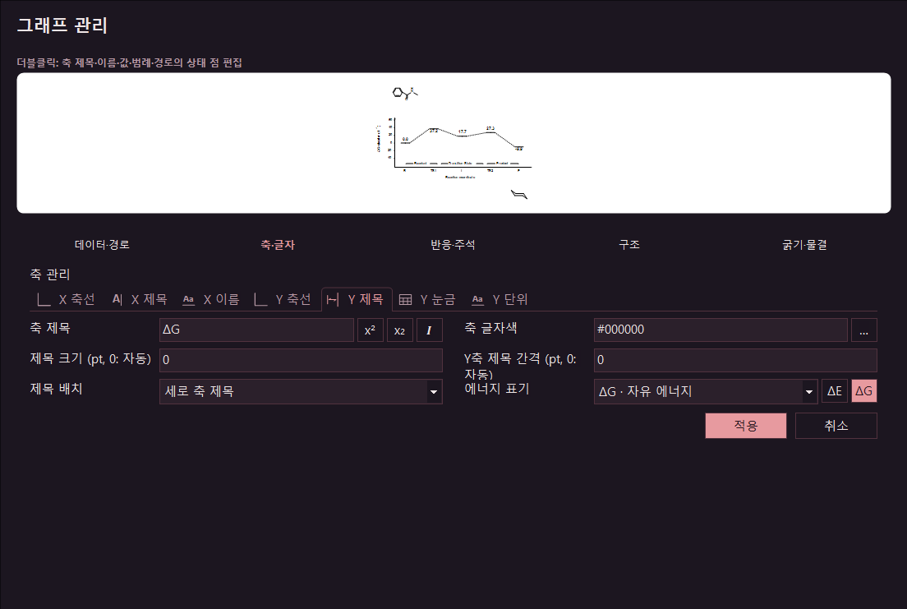

# 축 제목 편집 접근 개선

축 표기 변경에는 관리창·분류·세부 탭·드롭다운을 거쳐야 했다. 다시 열면 선택값이 ‘현재 표기 유지’로 보여 저장된 표기를 확인하기도 어려웠다.

- 선택 도구에서 캔버스의 X·Y축 제목을 더블클릭하면 해당 제목 설정을 바로 연다. 관리창 미리보기에서도 같은 접근을 제공한다.
- ΔE·ΔG 버튼을 한 번 누르면 제목과 표기가 함께 바뀐다. 기존 드롭다운과 직접 제목 입력도 유지한다.
- 직접 제목을 입력하면 직접 입력 모드로 전환하며, 다시 열 때 실제 선택값을 표시한다.
- 실행 중 마지막으로 보던 축 세부 탭을 기억한다.

그래프가 선택되어 있고 관리창이 닫힌 상태에서 Y축 표기를 바꾸고 적용하는 경로는 기존 관리창 → 축·글자 → 축 관리 → Y 제목 → 드롭다운 열기 → 표기 선택 → 적용(7회)에서 제목 더블클릭 → 표기 버튼 → 적용(4회)으로 줄어든다. 더블클릭은 마우스 버튼 두 번 누르기로 계산한다.

`axis_quick_access`는 캔버스의 세로·상단 Y축 제목, 미리보기 X축 제목, 마지막 탭과 현재 표기 유지, 표기 버튼, 직접 제목 입력, 한 단계 실행 취소, 잠금 보호를 검사한다. `plot_axes_manager`는 실제 네이티브 드롭다운 항목 클릭과 작은 창·일반 창의 컨트롤 배치를 검사한다. 축 제목에 붙인 장면 메타데이터는 클릭 대상을 식별하는 용도이며, 원래 글자·단위·위첨자·배치 검사도 유지한다.

로컬 전체 CTest 34/34(59.84초), 실행 파일의 20개 내보내기 검사, 프로젝트 그래프 문서 20개 복사본의 ΔE·ΔG 선택 및 캔버스 갱신 검사가 통과했다. 프로젝트 원본과 프로젝트 화면 캡처는 저장소에 포함하지 않는다. 아래 자료는 기본 예제로 촬영했다.

진단 로그와 프로젝트 복사본은 `build/axis-native-click`에 보관한다. 프로젝트 복사본의 재현 실행에는 `document_tabs_tests --project-axis-only project-fixtures/example.cdxml`을 사용하며, 실행은 `scripts/test-isolated.ps1`을 통한다.
