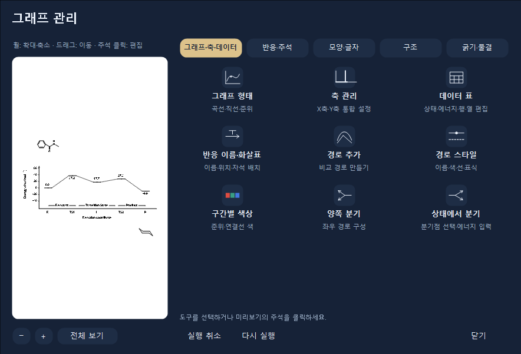
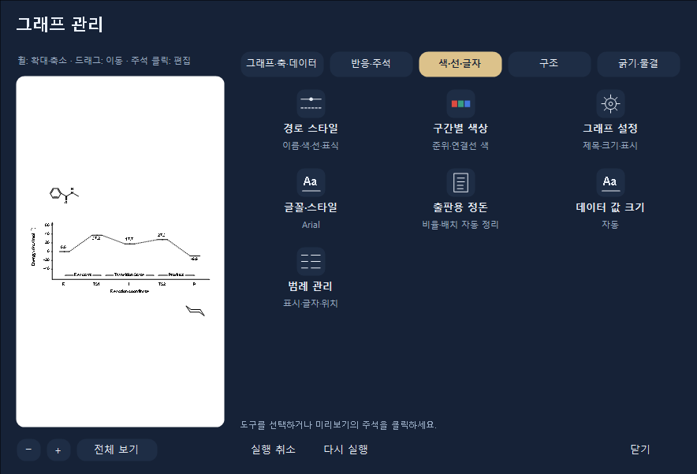

# 12월 UX 개선 1차 — 2026-11-26

상용화 준비의 첫 단계로, 기존 기능 접근을 보존하면서 그래프 서식의 분류와 명령 검색을 개선하고 반복 가능한 UX 평가 파이프라인을 추가했다. 12월 출시 승인이나 전체 정량 목표 달성을 의미하지 않는다.

## 사용자에게 보이는 변경

- 그래프 관리의 경로 스타일·구간별 색상을 `색·선·글자` 탭에 모았다. 그래프·축·데이터 탭에는 데이터, 경로 추가 및 분기 작업을 남겼다.
- 기존 경로 스타일 명령 ID 133 직접 호출도 해당 탭과 인라인 편집을 연다. 경로 추가는 데이터 탭에서 계속 사용한다. 편집 중 탭 전환, 입력 유지, 실행 취소 및 다중 경로 서식 회귀 검사를 통과했다.
- 명령 검색에 `color`, `energy`, `Mulliken`, `투명 배경`, `벡터`, `분자 분석` 등 작업 목적과 연구 용어를 추가했다. 기존 명칭·명령 ID를 유지하며 중복 검색 항목을 만들지 않는다.
- 주 편집기의 상단·좌우 도구 배치는 유지했다.

## 접근 비용: 이득과 비용을 함께 기록

관리 창이 열린 상태에서 기능을 여는 데 드는 클릭 수의 **소스 기반 모델**이다. 대상 선택, 값 입력, 최종 적용은 양쪽에서 제외한다. `글꼴 패널`은 현재 편집 패널을 닫는 1회를 포함한다. 실제 사용자 시간·빈도를 측정한 결과가 아니다.

| 시작 상태 → 기능 | 이전 | 이후 |
| --- | ---: | ---: |
| 서식 탭 → 경로 스타일 | 2 | 1 |
| 서식 탭 → 구간 색상 | 2 | 1 |
| 데이터 탭 → 경로 스타일 | 1 | 2 |
| 데이터 탭 → 구간 색상 | 1 | 2 |
| 글꼴 패널 → 경로 스타일 | 3 | 2 |
| 글꼴 패널 → 구간 색상 | 3 | 2 |
| 동일 가중치 합계 | 12 | 10 |

여섯 모델 경로의 합계 감소는 16.7%다. 서식 탭에서 두 색상 기능 접근은 각각 50% 줄지만 데이터 탭에서는 각각 1회 증가한다. 이는 전체 프로그램의 UX 개선율이 아니며, 실제 작업 빈도를 수집한 뒤 우선순위를 다시 평가해야 한다. 모델 정의는 [graph-before.json](graph-before.json), [graph-after.json](graph-after.json), [workflows.json](workflows.json)에 있다.

## 자동 검증

최종 로컬 빌드는 `build.ps1`로 수행했으며 격리 데스크톱 CTest **39/39**를 통과했다. 여기에는 감사 도구 수치·입력·HTML 검사 8개와 비교 도구 검사 16개를 실행하는 두 Python 테스트가 포함된다.

`scripts/ux-auditor.py`는 런타임 메뉴·검색·히트 영역·캡처 CSV를 읽고 기능 등록부, 방향 그래프, 명시적 작업 경로, 연관성 CSV, 비용 CSV, 기준값, 제약 검사 및 HTML 보고서 8종을 생성한다. Dijkstra 최단 경로, 가중 조작 비용, 선택적인 Fitts 지표를 지원한다. 검색 항목이 있다는 이유로 실제 검색 성공률을 계산하지 않으며, 미측정 인간 지표는 누락으로 남긴다. 자세한 계약은 [감사 도구 문서](../ux/README.md)에 있다.

`compare-ui-evidence.py`는 모든 히트 경로의 ID·개수·좌표를 보존 검사한다. 의도적인 위치 변경은 정확한 surface/ID를 지정한 `--constraints`의 `approved_moves`로만 허용한다. `locked`와 `forbidden`으로 고정·금지 위치를 지정할 수 있다. 승인된 이동도 기능 누락이나 새 부모 영역 이탈을 허용하지 않는다. 이번 변경은 편집기 히트 영역의 승인 예외 없이 통과했다. 그래프의 자식 버튼은 `controls.csv`에 기록되므로 탭별 버튼 분류는 C++ 회귀 assertion과 캡처로 별도 검증했다.

빌드의 기본 회귀 검사에도 감사 도구를 연결했다. `ux_runtime_audit`는 `ui_access_validation` fixture를 먼저 실행해 신선한 런타임 자료를 사용한다. GitHub Actions는 보고서와 CSV를 `YoungDraw-ux-audit` 산출물로 보관한다. 일반 CTest는 1440×900 요청·96 DPI fixture를 사용하고, 아래 별도 행렬 캡처는 3개 창 크기 × 4개 합성 DPI를 검사한다.

| 이번 로컬 전후 런타임 조사 | 이전 | 이후 |
| --- | ---: | ---: |
| 메뉴 말단 항목 | 95 | 95 |
| 명령 검색 항목 | 147 | 147 |
| 고유 런타임 명령/히트 ID | 158 | 158 |
| 캡처 | 168 | 181 |
| 기존 메뉴·검색 ID 누락 | — | 0 |
| 기존 히트 영역 누락·좌표 변경 | — | 0 |
| 표시된 직접 자식의 부모 영역 이탈 | 0 | 0 |

예전 보고서의 96/148과 달리 이번 fixture는 95/147을 관측했다. 같은 현재 소스의 전후 fixture끼리 비교했으며, 과거 수치를 이번 측정값으로 대신하지 않았다. 결과는 [preservation.json](preservation.json), [이전 기준값](before-ux_baseline.json), [이후 기준값](after-ux_baseline.json), 전후 `interaction_cost.csv`에 보관했다.

모든 UI/CTest 실행은 `scripts/test-isolated.ps1`의 별도 Windows 데스크톱에서 수행했고 화면을 전환하지 않았다. `WM_DPICHANGED` 요청은 96/120/144/192지만 실제 `GetDpiForWindow`는 모두 96이다. 실제 Windows 125/150/200% 배율 가독성 검증으로 해석할 수 없다. 캡처는 최소 크기 제한을 받으므로 요청 800×600이 실제 창 크기와 같다는 뜻도 아니다.

## 대표 화면

| 탭 | 이전 | 이후 |
| --- | --- | --- |
| 그래프·축·데이터 |  |  |
| 서식 |  |  |

## 재현

```powershell
./build.ps1 -BuildDirectory build/december-ux-final -HeadlessTests:$false
./scripts/test-isolated.ps1 -BuildDirectory build/december-ux-final `
  -Executable build/december-ux-final/ui_access_validation.exe `
  -Arguments @('--capture') -ArtifactDirectory build/december-ux-evidence/after
python scripts/ux-auditor.py --evidence-dir build/december-ux-evidence/after `
  --output-dir build/december-ux-evidence/audit-after `
  --graph docs/december-ux/graph-after.json --workflows docs/december-ux/workflows.json `
  --constraints docs/december-ux/constraints.json --fail-on-constraints
python scripts/compare-ui-evidence.py --before build/december-ux-evidence/before `
  --after build/december-ux-evidence/after --output build/december-ux-evidence/preservation.json
```

기준 소스는 `9fc80cf`이며 `build/december-ux-baseline`에서 빌드했다. 기준 캡처에는 `-Stage baseline`을 명시했다. 소스 기준 및 캡처 해시는 `evidence.json`에 보관한다.

## 출시까지 남은 검증

전체 기능과 선택 상태의 접근 경로 등록, 실제 사용 빈도 및 마우스 이동 측정, 인간의 첫 클릭 성공률 85%·아이콘 인식률 90%, 실제 DPI별 검증, 사용자 디자인 평가 및 실제 ChemDraw/PowerPoint 작업 호환성 시험이 남아 있다. 자동 회귀 통과와 인간 사용성·상용 출시 승인은 구분한다. 현재 연관성 행렬은 명시한 경로의 공동 등장 가중치이며, 실제 연속 사용 빈도나 QAP 최적화 결과가 아니다.
