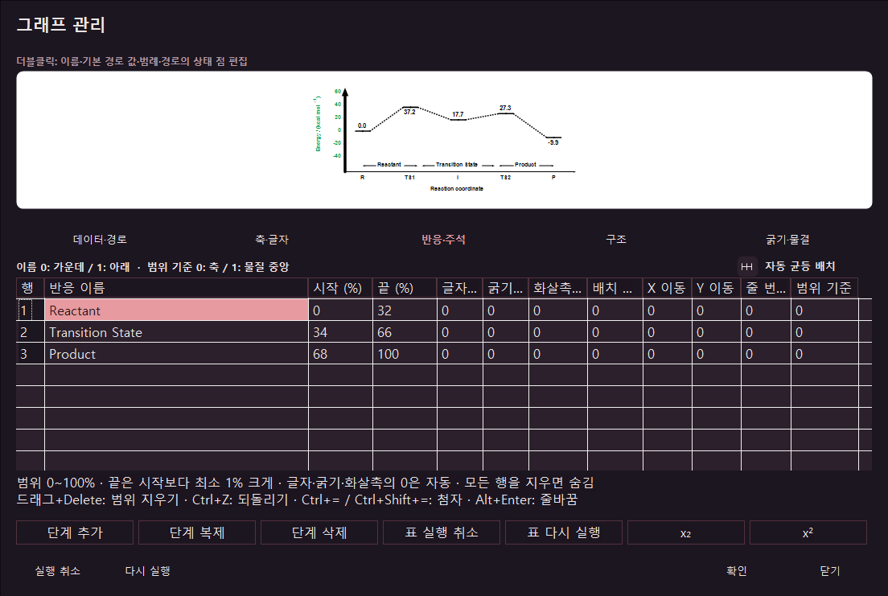
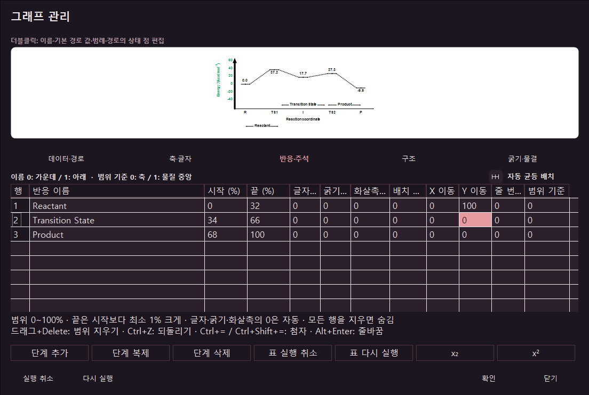
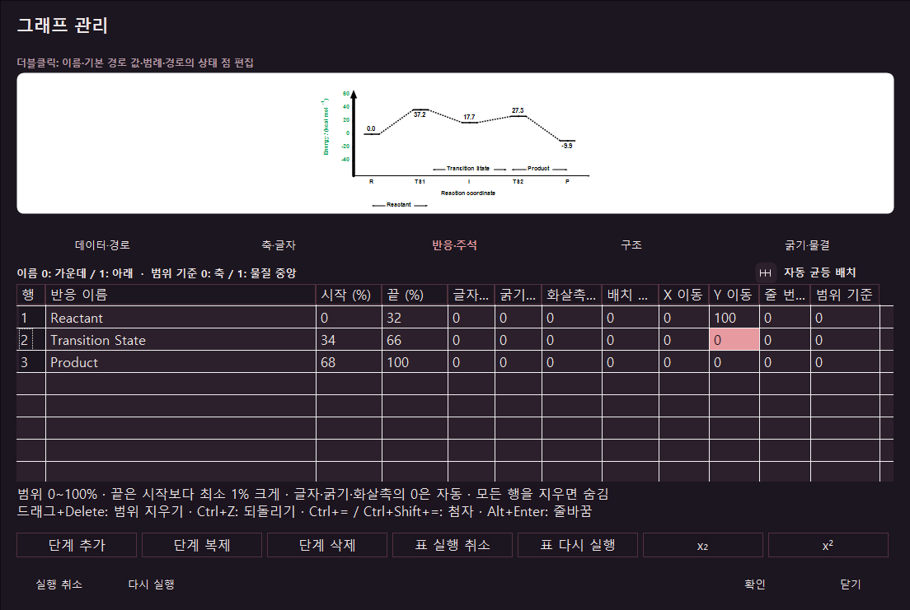

# 반응 이름·화살표 이동 중 축이 따라오는 문제

## 재현과 원인

그래프 관리 → 반응·주석 → 반응 이름·화살표에서 첫 반응의 `Y 이동`을 0에서 100으로 바꾸면, 실제 문서의 축 좌표와 에너지 값은 그대로인데 미리보기의 Y축이 오른쪽으로 이동하고 짧아졌다.

미리보기가 이동한 주석을 포함한 전체 장면의 경계에 매번 자동 맞춤하기 때문이다. 주석이 기존 경계 밖으로 나가면 확대 비율과 화면 원점까지 바뀌었다. 구조 그림이 없는 에너지 그래프로 재현했다.

| 같은 테스트 창의 Y축 픽셀 위치 | X | 위쪽 | 아래쪽 |
| --- | ---: | ---: | ---: |
| Y 이동 0 | 428 | 111 | 215 |
| 수정 전 Y 이동 +100 | 439 | 111 | 205 |
| 수정 후 Y 이동 +100 | 428 | 111 | 215 |
| 수정 후 Y 이동 −100 / X 이동 +80 | 428 | 111 | 215 |

이 숫자는 해당 테스트 창에서 측정한 값이며 모든 창 크기의 고정 좌표를 뜻하지 않는다.

## 수정

반응 이름 편집을 열 때의 미리보기 기준 영역을 유지한다. X/Y 이동은 이름과 화살표만 움직이고, 편집 중인 미리보기의 축 위치와 확대 비율은 유지된다. 창 크기를 직접 바꾸면 기존 기준 영역을 새 크기에 맞춘다. 편집 패널을 닫거나 다른 도구로 바꾸면 일반 미리보기 맞춤으로 돌아간다.

에너지 데이터·문서의 축 좌표·파일 형식·기존 아이콘 배치는 변경하지 않았다.

## 실제 화면

| 이동 전 | 기존 동작: Y +100 | 수정 후: Y +100 |
| --- | --- | --- |
|  |  |  |

## 회귀 검사

`plot_annotation_preview`는 격리 데스크톱에서 실제 표의 X/Y 셀을 편집하고, 렌더링된 검정 Y축 선의 위치와 길이를 픽셀로 비교한다. 문서의 축 좌표·데이터 보존, 가로축 아래로의 이름 이동, 창 크기 변경·복원, 한 단계 실행 취소도 검사한다. 수정 전에는 축 위치 비교가 실패했고 수정 후에는 같은 축 위치를 유지했다.

최종 동일 바이너리의 전체 CTest **32/32 통과(50.29초)**. 중간 검사에서 기존 PNG 클립보드 검사의 간헐 종료가 한 번 재발했다. 실패 로그는 `first-full-png-failure.log`에 보존했고, 같은 바이너리의 PNG 집중 검사와 최종 전체 재검사에서 통과했다. PNG·클립보드 코드는 이번 수정에서 변경하지 않았다.

```powershell
./build.ps1 -BuildDirectory build/stage-preview-anchor -TestFilter '^plot_annotation_preview$'
```

원시 재현 로그와 PNG는 `build/stage-preview-anchor/reproduction/`, 수정 후 검사 자료는 `build/stage-preview-anchor/`에 보관한다. 모든 로컬 UI/CTest는 `scripts/test-isolated.ps1`을 사용했으며 사용자 데스크톱으로 전환하지 않았다.
