# UI 접근 경로와 검증 기록 — 2026-11-23

## 근거와 측정 범위

Agent D는 `tests/`, `scripts/`, `docs/`만 수정했다. 앱 변경은 Agent A/B/C와 통합 담당자가 수행했다. 기준 앱 소스는 D 작업 트리에 그대로 보존했으며, 기준 화면은 `build.ps1`로 빌드한 앱과 같은 `youngdraw_editor` 라이브러리를 링크한 검증 실행 파일에서 얻었다. 로컬 UI/CTest 실행은 모두 `scripts/test-isolated.ps1`을 거쳤다.

아래 클릭 수는 **소스에서 확인한 경로를 재현하는 데 필요한 마우스 버튼 누름 수**다. 더블클릭은 2회, 우클릭은 1회다. 타이핑과 키보드 입력은 별도이며 사람이 작업하는 시간을 측정한 결과가 아니다. 이미 선택된 대상에서 시작하고, 양쪽에 공통인 대상 선택과 편집창의 최종 적용은 제외한다. 새 빠른 경로 때문에 기존 키보드 경로까지 빨라졌다고 해석하지 않는다.

## 다섯 작업의 전후 경로

| 작업과 동일한 시작 조건 | 이전 경로 / 누름 수 | 이후 경로 / 누름 수 | 창 전환과 해석 |
| --- | --- | --- | --- |
| 구조 서식: 선택한 화살표를 약 15% 굵게 | 우클릭 → 선택 편집 → 굵기 입력칸 → 확인: 4회 + 입력 | 선택 서식의 선 굵게 아이콘 `269`: 1회 | 속성 대화상자 진입·복귀가 사라진다. 임의의 정확한 값 입력은 기존 속성창을 사용한다. |
| 메커니즘: 선택한 단계 이름 수정 | 이름·에너지 아이콘 `30` → 입력 → 적용: 2회. 첫 입력칸은 자동 포커스 | 같은 창의 이름 칸 `80` 클릭 → 입력: 1회 | 추가 이름·에너지 대화상자 1개를 생략한다. 메커니즘 전체 적용/취소는 양쪽 모두 유지된다. 기존 F2 경로는 이미 마우스 0회다. |
| 그래프: 데이터 분류에서 특정 상태/기본 경로 값 수정 | 데이터 표 카드 `131` 1회 → 셀 더블클릭 2회: 합계 3회 | 미리보기의 대응 상태/기본 경로 값 더블클릭: 2회 | 다른 분류에서 시작하면 이전은 분류 탭까지 4회다. 표는 기존처럼 같은 관리창에 열린다. 제목·범례는 이전 탭+카드 2회와 같을 수 있어 보편적인 클릭 절감으로 계산하지 않는다. |
| 템플릿·프로젝트: 선택한 파일 이름만 수정 | 이름·노트 아이콘 `24` → 자동 포커스 입력 → 적용: 2회 | 이미 선택된 이름을 느리게 클릭 → 입력 → Enter: 1회 | 이름·노트 대화상자 1개를 생략한다. F2 전체 편집은 유지되고 Ctrl+F2 이름 편집은 추가 경로다. 템플릿 갤러리 삽입·즐겨찾기에는 이번 변경에 따른 클릭 절감을 주장하지 않는다. |
| 저장·내보내기: 저장된 문서를 같은 폴더/이름으로 SVG 내보내기 | 내보내기 → 기본 `structure.svg` 이름 교체 및 폴더 이동 → 저장 | 내보내기 → 문서 이름의 `.svg`와 문서 폴더 확인 → 저장 | 파일 선택창은 양쪽 1개다. 사전 설정으로 이름 재입력·폴더 재탐색을 줄인다. 탐색 깊이와 기존 Windows 폴더 상태에 따라 누름 수가 달라 고정 절감 수를 만들지 않는다. 명시한 초기 폴더는 우선한다. |

그래프의 여러 경로 중 **실제 상태 스냅 점**은 해당 경로의 셀로 연결한다. 떠 있는 값 라벨의 직접 연결은 기본 경로만 대상으로 한다. 다른 경로의 값 라벨에는 경로 식별 정보가 없어 기본 경로로 임의 연결하지 않는다. 프로젝트 검색 후 Enter는 마우스 없이 첫 결과를 열지만, 기존 결과 목록의 Enter도 마우스 0회였으므로 키보드 절감 수는 0으로 본다.

## 기능·접근 경로 목록

`scripts/audit-ui-source.py`는 `src/*.cpp`, `src/*.h`, `resources/*.rc` **92개 파일**의 문자열 후보 전체를 수집했다. 기준 스냅샷에는 문자열 리터럴 후보 60,215개, 그중 wide 문자열 2,644개가 있다. 화학 템플릿 데이터, 파일 형식, 내부 오류 문자열도 포함하므로 이것은 UI 문자열 개수가 아니다. 파일·줄·원문·문맥·소스 SHA-256을 JSON에 남기고, 실제 표시/실행 여부는 아래 런타임 목록과 구분한다.

| 영역 / 주요 구현 | 유지해야 하는 접근 경로와 기능 |
| --- | --- |
| 시작과 주 편집창 — `winmain`, `win_splash`, `win_editor_window` | 시작 화면, 실행 인자, 독립 구조 편집 창, 창 크기 변경, 드래그 파일 열기, Office 임베딩 |
| 문서 — `win_editor_tabs`, `win_editor_files` | 새 탭 `100`, 열기 `101`, 저장 `102`, 닫기 `109`, 닫은 탭 복원 `256`, 최근 문서 `233`; Ctrl+N/T/O/S/W, Ctrl+Shift+T |
| 메뉴·아이콘·툴팁 — `win_editor_chrome`, `win_editor_canvas`, `win_button_help` | 파일·편집·삽입·배치·보기 메뉴, 상단 아이콘 순서와 히트 영역, 좌·우 도구, 도구 모음 스크롤, 즐겨찾기 고정, 버튼 도움말 |
| 선택·그리기 — `win_editor_pointer`, `win_editor_shortcuts` | 선택/이동, 단·이중·삼중·쐐기·해시·점선 결합, 고리, 벤젠, 원소·전하·라디칼, 지우개, 직선·공명·전자 이동 화살표, 오비탈, 그룹·해제 `198/199`, 객체 맞춤 `190..197` |
| 구조 편집 — `win_editor_structure`, `win_editor_commands` | 구조 정리 `110`, 회전·반전 `160..165/258`, 축약 `166/226`, 입체 회전 `260`, 분자 주석 `261/262`, 스핀 `227`, 독립 구조 창 `186`, 문서 서식 `150` |
| 텍스트·색 — `win_editor_text`, `win_color_picker` | 인라인 편집, 첨자·줄바꿈·리치 텍스트, 원자 색 `155`, 텍스트 색 `156`, 화살표 색 `259`, 기존 선택 편집 `121`; 추가 빠른 서식 `263..269`는 지원되는 선택에서만 노출 |
| 메커니즘 — `win_editor_reaction`, `win_mechanism_editor`, `mechanism_*` | 생성 `120/221`, 관리 `254`, 편입 `255`, 인식 `223`, 분기 `169/220`, 단계·연결 `143..149`, 구조 그림 칸, 자동 정렬·순환 `125/126`, 설정 `127`, 개별 연결·화살표, 원본 비교·초안 취소·되돌리기 |
| 그래프 — `win_editor_plot`, `win_plot_manager`, `plot_data` | 생성 `130/235`, 데이터 `131`, 경로 `132/133`, 양쪽 분기 `135`, 스냅 배치 `136`, 축 설정 `137/239`, 출판 정돈 `138`, 반응 이름 `139`, 구간 색 `142`, 교차 `151`, 주석·갭 `236/237`, 스타일 `238`, 글꼴 `253`, 범례 `249`, 물결 `250/251`, 구조 칸·다중 경로·단위 |
| 갤러리 — `win_editor_templates`, `win_gallery` | 템플릿 삽입 `111`, 저장 `112`, 파일 삽입 `113`, 분류·검색·페이지·금속 선택, 사용자 템플릿 편집/이름/이동/삭제, 즐겨찾기; 기존 152개 + 리간드 14개는 기존 회귀 검사 대상 |
| 프로젝트 — `win_projects`, `win_project_manager` | 프로젝트 `185`, 생성/가져오기/내보내기/복제/정보/휴지통, 폴더·다중 선택·이동·순서·검색, 노트 자동 저장, 원본 위치·ZIP·미리보기; 전체 이름·노트 편집 `24/F2`와 목록 Enter 유지 |
| 공통 입력창 — `win_dialogs`, `win_grid` | 검색, 그래프·메커니즘 선택기, 모달/내장 폼과 표, 셀 편집, 유효성 확인, 적용·취소·미리보기, 글꼴/색 선택 |
| 애니메이션 — `win_editor_animation`, `win_editor_images` | GIF 생성 `222`, 연결 경로 선택, 미리보기·재생·중간 프레임·진행 표시·취소, 이미지/GIF 불러오기와 편집 |
| 파일 호환·출력 — `cdx`, `cdxml`, `win_storage`, `win_recovery`, `win_editor_render` | `.ydraw`·CDXML·CDX, 미지원 XML 보존, 원자적 저장·복구, SVG `103/106`, CDXML `108`, PNG `247`, PNG 복사 `248`, TIFF `257`(독립 창), GIF, 투명도·기하·수치 보존 |
| Office·클립보드 — `office`, `win_editor_clipboard` | 구조·벡터·PNG 복사/붙여넣기, Office 개체 저장/복원·독립 편집·적용/취소, PowerPoint 연계 |
| 테마·도움말 — `win_theme`, `win_editor_shortcuts`, `third_party_notices` | 기존 7개 테마·배경/패턴 `184`, 명령 검색 `230/Ctrl+Shift+F`, 도움말 `231/F1`, 단축키 설정 `232`, 라이선스 `234`, 도구/레이어·화면 맞춤·예제 |

스캔에 등장한 `YoungDraw*` 클래스 문자열은 21종이다. 일반 파일 선택창·메시지 상자와 기본 Win32 컨트롤은 이 수치에 포함되지 않는다. 클래스 문자열의 존재만으로 창이 실제 생성됐다고 판정하지 않는다.

## 기준 캡처와 한계

기준 캡처 `build/ui-before-final`은 **168장**이다. 주 편집기, 그래프 관리 5분류, 메커니즘과 3분류, 템플릿, 문서 서식, 프로젝트, SVG 저장의 14개 상태 × 12조합을 기록했다. 모달창은 `PrintWindow(PW_CLIENTONLY)`, 주 편집기는 실제 `paint` 처리기를 같은 테스트 창의 크기로 호출했다. 사용자 화면이나 다른 프로그램을 캡처하지 않았다. 주 편집기 이미지는 물리 화면 전체 스크린샷이 아니라 실제 편집기 렌더러의 클라이언트 출력이다.

| 요청 창 크기 | DPI 변경 메시지 | 관측 결과 |
| --- | --- | --- |
| 800×600 | 96 / 120 / 144 / 192 | 소형 창 경로, 실제 클라이언트 크기는 CSV 기록 |
| 1440×900 | 96 / 120 / 144 / 192 | 일반 창 경로 |
| 2560×1440 | 96 / 120 / 144 / 192 | 큰 창 요청. 일부 대화상자는 기존 최대 창 크기/화면 작업 영역에 제한됨 |

모든 기준 창에서 `GetDpiForWindow`는 **96**을 반환했다. 120/144/192는 125/150/200%에 해당하는 **합성 `WM_DPICHANGED` 메시지 값**이며, 실제 모니터 배율 시험이나 폰트 확대 시험이 아니다. 시스템 배율을 변경하거나 사용자 데스크톱으로 전환하지 않았다. 실제 125/150/200% 모니터에서의 물리적 가독성과 잘림 검사는 남아 있다.

`controls.csv`는 표시된 **직접 자식 컨트롤**의 사각형이 부모 영역을 벗어나는지 기록한다. 기준 168상태에서는 벗어난 직접 자식 0개였다. 중첩 컨트롤, 텍스트 자체의 잘림, 모든 겹침을 자동 증명하는 검사는 아니다. 작은 창의 힌트 말줄임표와 스크롤은 실제 이미지로 별도 검토해야 한다. 그래프/프로젝트 등 창별 최소/최대 크기도 CSV의 실제 크기로 해석한다.

사용자 HKCU 설정은 `RegOverridePredefKey`로 테스트 프로세스 안에서 임시 키로 연결하고, 종료 시 복원·정리한다. 기준/이후는 테마 0을 명시해 같은 팔레트를 사용한다. 파일·프로젝트는 캡처 디렉터리 안의 별도 APPDATA/LOCALAPPDATA에 만든다. 일반 Windows 파일 선택창은 가시 상태를 확인하고 초기화 시간을 기다린 뒤 캡처한다. 단색 캡처는 실패 처리하고 진단 PNG를 보존한다.

## 전후 대조 결과와 대표 이미지

기준 앱 소스는 `fcf82ac85bc2fd5541bcd517dfe119a7487c81d2`다. 이후 캡처는 통합 앱 라이브러리에서 **181장**을 얻었다. 기준과 같은 168상태, 메커니즘 이름 직접 편집 12상태, 선택 서식 1상태다. `compare-ui-evidence.py`로 독립 대조한 결과는 다음과 같다.

| 확인 항목 | 기준 | 이후 | 결과 |
| --- | --- | --- | --- |
| native 메뉴의 말단 명령 수 | 96 | 96 | 기존 ID와 중복 횟수 모두 보존 |
| 명령 검색 항목 | 141 | 148 | 기존 141개 포함, 빠른 서식 7개 추가 |
| 12개 같은 편집기 상태의 기존 히트 ID·사각형 | CSV 기준 | CSV 대조 | 누락·좌표/크기 변경 0개 |
| 기준 캡처 상태 이름 | 168 | 모두 존재 | 누락 0개 |
| 표시된 직접 자식의 부모 영역 이탈 | 0 | 0 | 중첩 컨트롤/문자 잘림까지 뜻하지 않음 |
| 실제 `GetDpiForWindow` | 96 | 96 | 실제 모니터 배율 검증으로 해석하지 않음 |

선택 서식 assertion은 실제 `WM_LBUTTONDOWN/UP`로 아이콘 히트 경로를 실행해 폰트 크기가 바뀌는지 확인했다. 원자/결합의 폰트·굵기 변경과 1회 Undo, 혼합 선택의 리치 텍스트 크기 비율·글꼴·색 보존, 잠금 이미지/그래프 보존, 지원 대상이 없을 때와 폰트 상한에서의 무변경·빈 Undo, 텍스트 이탤릭과 Undo도 통과했다. 메커니즘에서는 한 포커스 안의 여러 이름 변경이 실제 목록에 즉시 반영되고, Undo 1회로 전체 입력을 복원하며, 바깥 취소가 원본 문서를 유지하는지 확인했다. UI 메시지 기반 회귀 검사이며 사람의 사용 관찰 결과는 아니다.

대표 PNG는 가공 없이 원본을 복사했다. 이미지 SHA-256과 캡처/범위 요약은 [evidence.json](ui-evidence-20261123/evidence.json)에 있다. 전체 행렬의 원본은 `build/ui-before-final`과 통합 작업 트리의 `build/november-ui-evidence/ui-after`에 남긴다.

같은 800×600 요청에서 주 편집기의 기존 아이콘 배치:

| 이전 | 이후 |
| --- | --- |
|  | 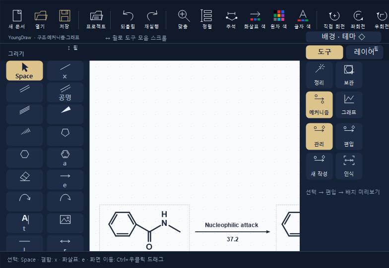 |

메커니즘의 이전 기본 상태와 이후 단계 선택·이름 입력 상태. 이후에는 같은 창 아래에 이름/에너지 칸이 보인다. 양쪽 선택 상태가 같다는 비교는 아니다.

| 이전 | 이후 |
| --- | --- |
| 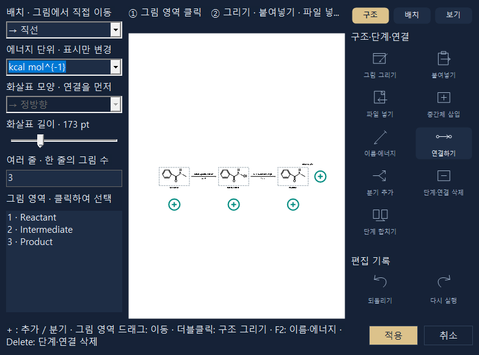 | 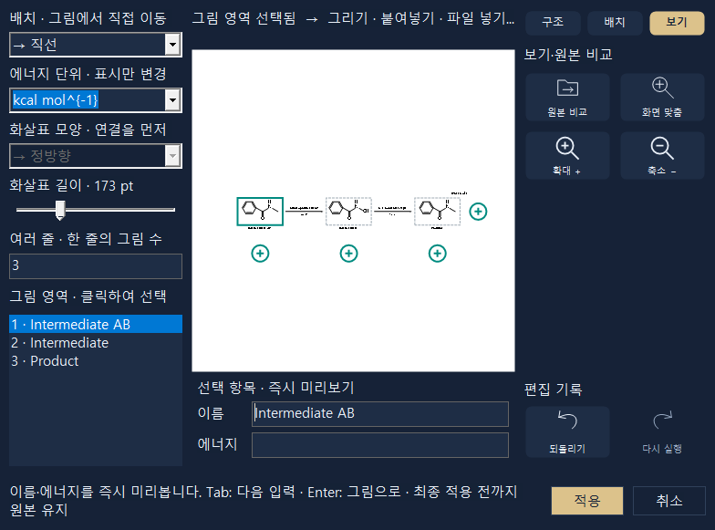 |

같은 800×600 요청에서 프로젝트 목록. 기존 아이콘 순서를 유지하며 작은 창에서 목록 높이를 확보한다.

| 이전 | 이후 |
| --- | --- |
| 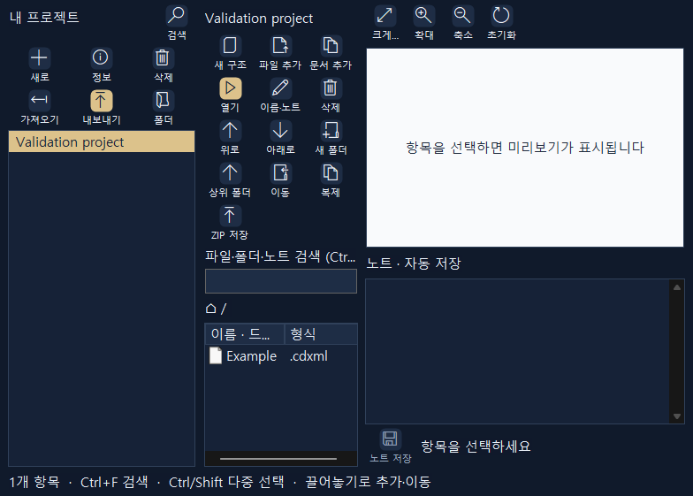 | 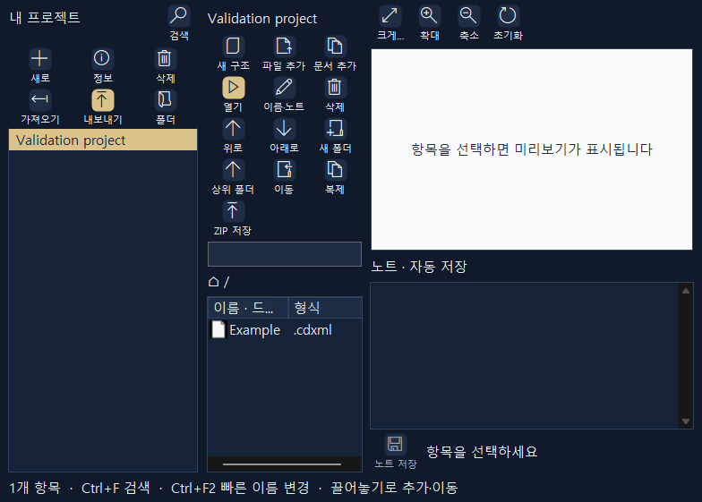 |

선택한 원자·결합에서 표시된 빠른 서식 아이콘. 이 그림의 요청 DPI는 192지만 실제 DPI는 96이며, 200% 모니터 화면으로 표시한 것이 아니다.

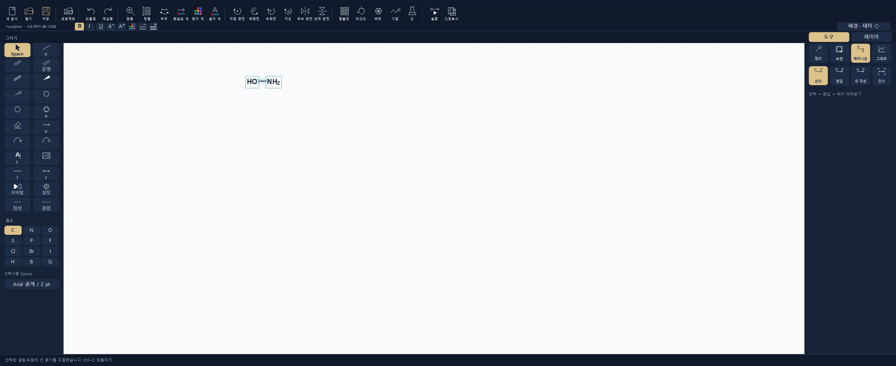

같은 그래프 관리 분류의 전후 화면. 기존 아이콘 위치를 유지하며 미리보기에서 직접 편집하는 경로를 안내한다.

| 이전 | 이후 |
| --- | --- |
| 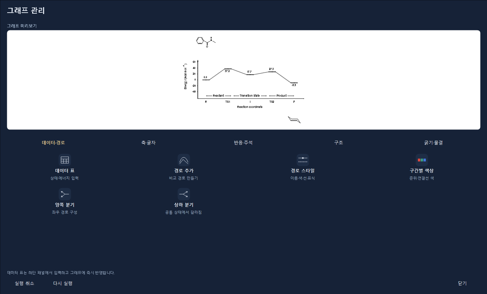 | 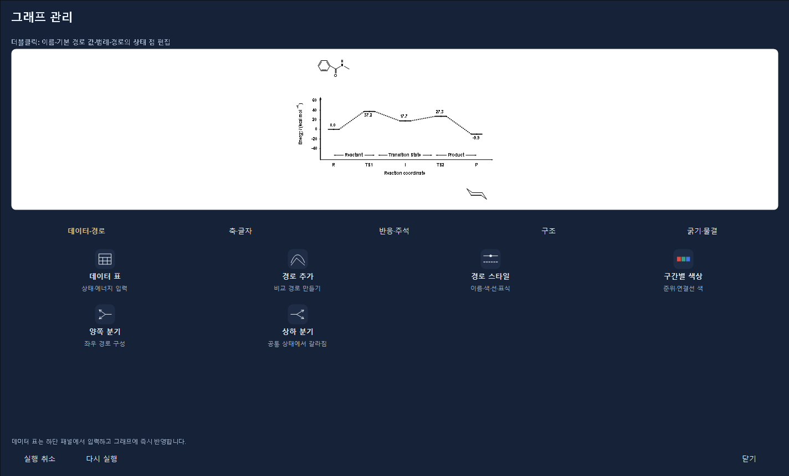 |

템플릿 갤러리의 같은 창 크기와 분류. 삽입·즐겨찾기 경로를 유지하고 동작 설명을 정리했다.

| 이전 | 이후 |
| --- | --- |
| 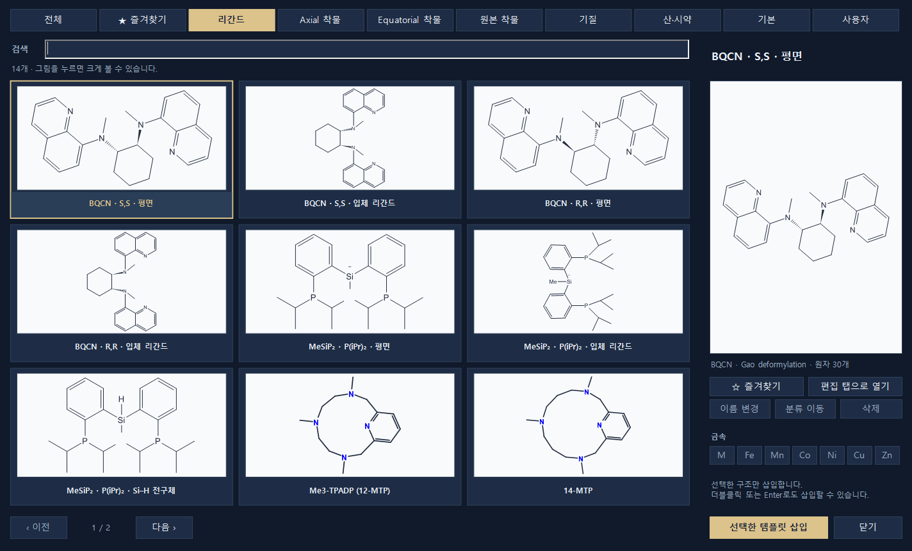 | 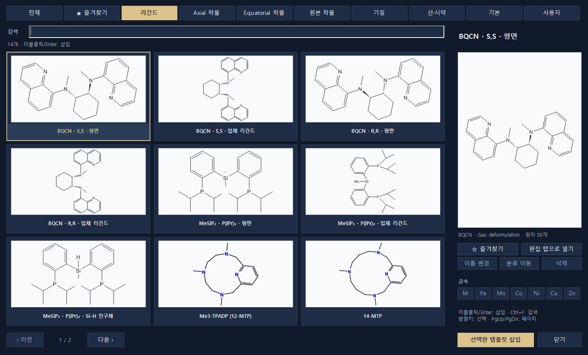 |

저장된 문서를 SVG로 내보내는 실제 파일 선택창. 이전의 `structure` 대신 문서 이름 `validation-example`이 표시되고 문서 폴더에서 시작한다. Windows의 확장자 숨김 설정에 따라 `.svg`는 입력란에 표시되지 않는다. 이후 native 입력란·주소 확인 검사에서 문서 폴더와 명시 초기 폴더 우선순위가 모두 통과했다.

| 이전 | 이후 |
| --- | --- |
| 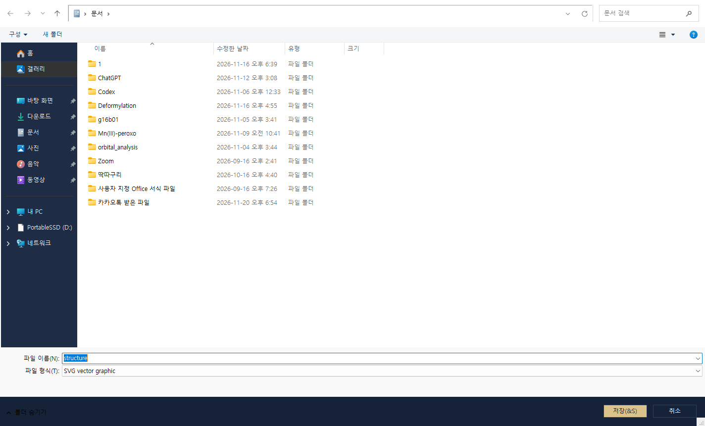 | 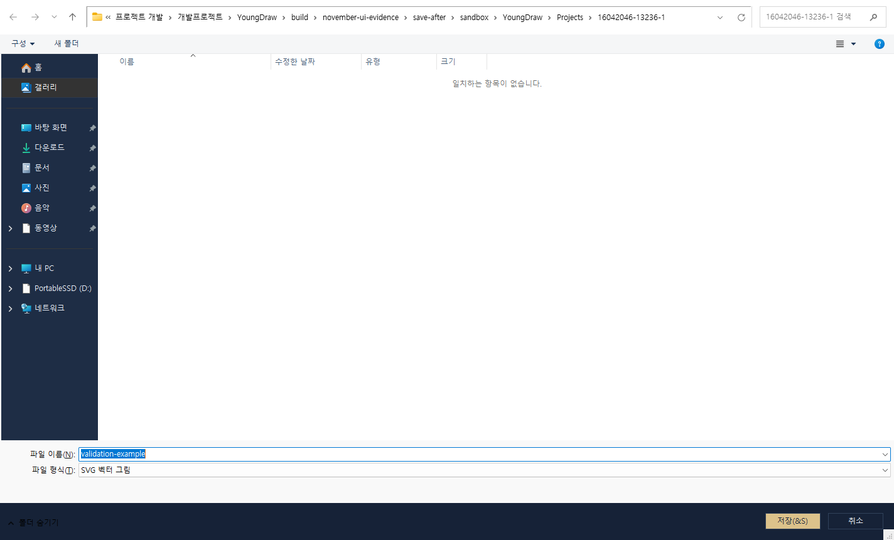 |

## 재현 명령과 자료

각 빌드는 `build.ps1`로 수행한다. CMake의 `ui_access_validation` 대상은 통합 담당자가 등록한다. 기본 CTest 실행은 이후 동작 검증이며, 기준 앱에만 `-Stage baseline`을 명시한다. 기준 모드는 새 기능의 assertion을 생략하는 용도이고 최종 전체 회귀 검사에 사용하지 않는다.

```powershell
# 검증 실행 파일 경로와 출력 폴더는 각 작업 트리 기준이다.
& ./scripts/test-isolated.ps1 -BuildDirectory ./build/ui-baseline `
  -Executable ./build/ui-baseline/ui_access_validation.exe `
  -Arguments @('--capture') -ArtifactDirectory ./build/ui-before-final -Stage baseline

# 저장된 문서의 이름/폴더와 명시 초기 폴더 우선순위: 실제 native 컨트롤 확인
& ./scripts/test-isolated.ps1 -BuildDirectory ./build/ui-baseline `
  -Executable ./build/ui-baseline/ui_access_validation.exe `
  -Arguments @('--save-probe') -ArtifactDirectory ./build/save-before-native -Stage baseline

# 이후 앱에서도 별도 폴더에 --capture / --save-probe를 수행한다(Stage after).
python ./scripts/compare-ui-evidence.py --before ./build/ui-before-final `
  --after <after-evidence-directory> --output ./build/ui-comparison.json

# 배포할 실제 단일 실행 파일의 CLI 시작·출력 검증. 새 출력 폴더를 사용한다.
& ./scripts/test-portable-smoke.ps1 -Executable <YoungDraw.exe> `
  -ArtifactDirectory ./build/portable-smoke

# Visual Studio 다중 구성 CTest도 같은 격리 진입점을 사용한다.
& ./scripts/test-isolated.ps1 -BuildDirectory ./build/ci -Configuration Release

# subst 드라이브를 사용하는 로컬 Ninja CTest는 드라이브가 살아 있는 빌드 안에서 수행한다.
& ./build.ps1 -BuildDirectory build/november-ui-final -TestFilter '^ui_access_validation$'
```

원시 자료는 ignored `build/`에 보관한다. `captures.csv`는 요청/실제 크기·요청/실제 DPI·렌더링 방법·비단색 표본 수, `menus.csv`는 ID/깊이/경로, `commands.csv`는 검색 ID/제목/설명, `hits.csv`는 실제 표시된 편집기 히트 사각형, `controls.csv`는 자식 컨트롤 영역을 담는다. `isolated-run.json`은 지원되는 실행의 도구/실행 파일 SHA-256과 인자를 기록한다. 나중에 추가된 이 receipt가 없는 초기 기준 캡처에는 receipt가 있었다고 주장하지 않는다.

저장 probe의 `CDM_GETFILEPATH`/`CDM_GETFOLDERPATH`는 관측한 Windows 파일 선택창에서 0을 반환했다. 이를 앱 오류로 처리하지 않고 CSV에 `unsupported-by-observed-dialog`로 명시했다. 같은 테스트 창의 native Edit `1001`과 주소 Toolbar `1001`의 실제 텍스트를 기록해 이름·폴더를 확인한다. 기준 이름은 `structure`였으며 Windows가 확장자를 숨긴 상태다. 전체 경로를 질의해 얻은 것처럼 표현하지 않는다. 지정한 초기 폴더의 전체 경로는 실제 주소 컨트롤에서 확인했다.

`compare-ui-evidence.py`는 기준 메뉴 ID의 중복 횟수, 검색 ID의 포함 관계, 같은 편집기 상태/크기의 기존 히트 사각형 보존을 검사한다. 새 항목은 허용한다. 스크롤 밖의 아이콘과 모든 기능의 의미적 동등성을 단독으로 증명하지 않으며, 기능/호환성 회귀 검사와 함께 해석한다. 정적 후보 목록에서 갤러리 ID가 사라져도 툴팁 테이블을 switch로 바꾼 경우가 있으므로 곧바로 기능 삭제로 판정하지 않는다.

실제 `YoungDraw.exe --export-demo` 검증은 GUI 프로그램이 끝날 때까지 해당 테스트 프로세스를 기다린다. 출력 20개의 존재/크기, PNG 서명, SVG/CDXML 루트 요소를 검사하고 실행 파일·각 출력의 SHA-256을 `smoke.json`에 남긴다. D 기준 빌드에서 일반 경로와 공백·한글 포함 경로 모두 통과했다. 라이브러리 UI 검증과 실제 실행 파일의 CLI 시작 검증은 다른 증거다. 이 CLI 검증만으로 모든 포터블 GUI 작업을 검증했다고 주장하지 않는다.

## 최종 통합 검증

- 격리 데스크톱의 최종 동일 바이너리 CTest **31/31 통과, 48.84초**. 메커니즘 초안 취소·입력 단위 실행 취소, 그래프의 상태/경로별 직접 편집, 프로젝트 이름 변경·확정·취소·기존 F2 경로를 포함한다.
- 프로젝트 이름 입력에서 native 편집 컨트롤의 `EN_UPDATE`가 ID `1`로 전달돼 열기 명령으로 처리되는 문제를 실제 메시지 기록으로 확인했다. 열기·닫기 명령에 알림 종류 검사를 추가했고, 입력·Enter·Esc와 원래 전체 편집창 회귀가 통과했다.
- native 저장창의 문서 이름·문서 폴더 기본값, 명시한 초기 폴더 우선순위 검사가 통과했다. 실제 실행 파일도 종료까지 기다려 출력 20개를 확인했다.
- 중간 전체 검사에서 PNG 클립보드 검사가 한 번 비정상 종료됐다. 같은 테스트 바이너리의 PNG 집중 검사 3회와 최종 전체 검사에서 모두 통과했다. 실패 로그는 `build/november-ui-final/isolated-ctest-png-failure.log`에 보존했으며, 재현 근거 없이 PNG 편집·출력 코드를 변경하지 않았다.
- 미완료: 실제 125/150/200% 모니터에서의 물리적 배율 검증과 처음 사용하는 사람을 대상으로 한 사용성 평가는 수행하지 않았다. 합성 DPI 메시지 검사나 소스 기반 클릭 수를 이 검증으로 대신했다고 표현하지 않는다.
